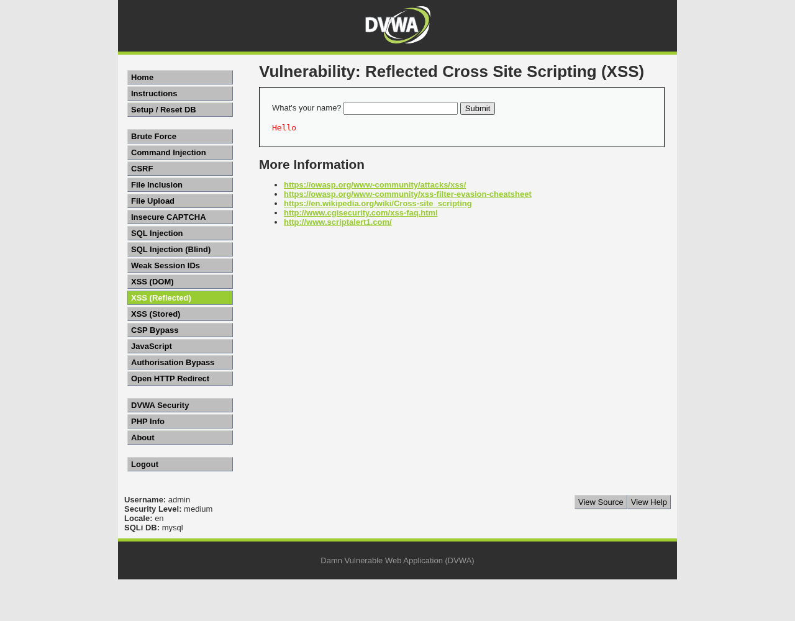
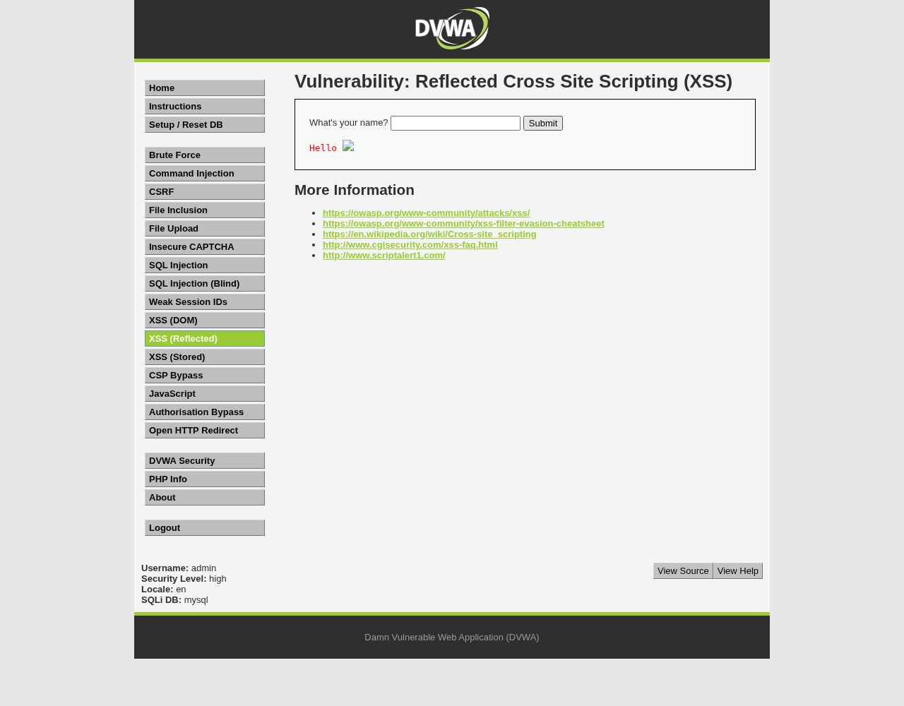
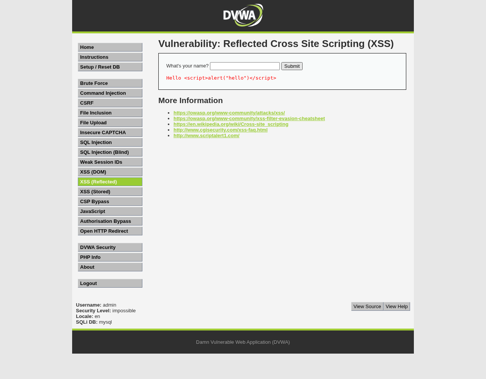
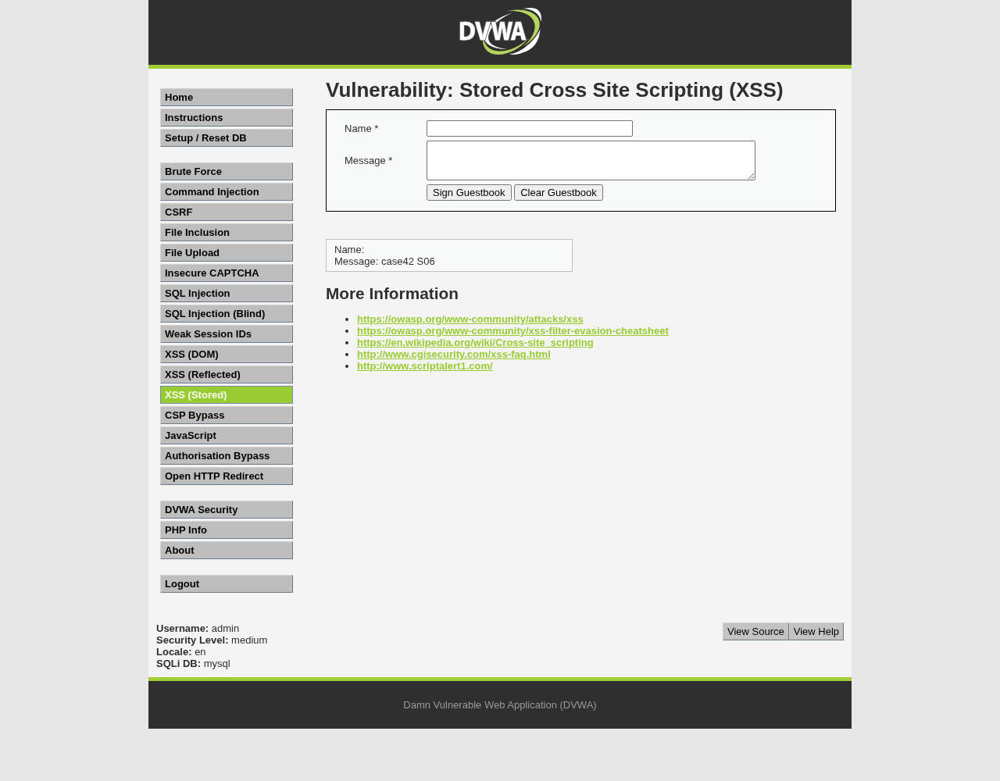

# 案例 4-2：DVWA 反射型与存储型 XSS 复现实验报告

实验日期：2026 年 10 月 27 日（北京时间）  
实验材料：用户提供的案例 4-2 共七张截图  
实验对象：本服务器新建的本机 DVWA 靶场  
报告性质：实际运行记录及可重复操作指南

## 1. 实验目的与已完成范围

本实验复现教材中的两类跨站脚本漏洞。XSS 指网页把用户提供的内容当作 HTML 或 JavaScript 解释，使用户输入中的脚本在浏览器里执行。反射型 XSS 的输入来自当次请求，服务器在当次响应中返回；存储型 XSS 则先把输入写入数据库，在以后有人访问页面时再次输出。

实验覆盖 low、medium、high、impossible 四个级别，既运行教材的有效输入，也运行本应失败的对照输入。主要实验共 34 项，34 项符合预期；另外完成 2 项本机 Cookie 补充核验。这里的“通过”表示实测符合该项预期，包含“脚本被阻断”的成功对照，不能理解为所有输入都成功注入。

全部目标都在 127.0.0.1，未测试第三方网站。Cookie 仅在本机显示和验证，不向外部收集地址发送。实验只使用 CPU。text2video 的模型、训练、数据缓存及现有数据库均不属于本次操作范围。

## 2. 环境、版本和目录

|组件|本次实际环境|
|---|---|
|系统|Ubuntu 20.04 用户空间，Linux 5.15.0-46-generic，x86_64|
|权限|普通用户 wxy，无 Docker socket 权限|
|PHP|7.4.3-4ubuntu2.20，CLI 内置 Web 服务|
|数据库扩展|php7.4-mysql 7.4.3-4ubuntu2.29，仅解压到用户目录；mysqli、mysqlnd、pdo_mysql 实测加载成功|
|MySQL|5.7.24，服务器已有的 Conda 二进制，另建独立实例|
|DVWA|官方 Git tag 2.3，commit 34a10d4166dcdc31f9641cf36ba5bd0fc1d4c59c|
|浏览器|Chromium 140.0.7339.16，Playwright 1.55.0，真实浏览器执行 JavaScript|
|主站|http://127.0.0.1:18042，数据库 dvwa_case42|
|自动实验临时站|http://127.0.0.1:18043，每一组使用新的数据库，测完停止该临时网页服务|
|手动练习站|http://127.0.0.1:18044，按需启动，每次生成新数据库|
|数据库监听|127.0.0.1:13342；未连接现有 3306/33060 实例|
|登录账号|admin / password，仅为教学靶场默认账号|

实验目录：

```text
/home/wxy/text2video/.trae/reference/dvwa-case42-20261027
├── DVWA/                     官方源码；漏洞处理代码未修改
├── downloads/                官方源码压缩包、PHP扩展包、tag元数据
├── requirements.lock.txt     本次Python依赖的确切版本
├── scripts/
│   ├── bootstrap.sh          首次安装用户目录依赖并启动
│   ├── lab.py                主服务启动、状态查询和停止
│   ├── practice.py           创建干净手动练习站，不清旧数据
│   ├── reproduce.py          34项真实浏览器实验及2项补充核验
│   └── build_report.py       从实测结果生成报告
├── runtime/                  本机依赖、独立数据库、日志和PID
└── results/                  每次新建时间戳目录，不覆盖上次实验
```

本次原始证据目录：`/home/wxy/text2video/.trae/reference/dvwa-case42-20261027/results/20261027_193731`。正式报告放在 `.trae/documents/CASE42_复现报告_20261027/`。项目的 `.trae` 为独立知识库，本轮未提交或推送任何仓库。

## 3. 最快复现：当前服务器直接使用

### 3.1 启动并检查

在服务器终端执行：

```bash
cd /home/wxy/text2video/.trae/reference/dvwa-case42-20261027
runtime/venv/bin/python scripts/lab.py start
runtime/venv/bin/python scripts/lab.py status
```

状态应包含 `"php": true`、`"mysql": true` 和 `"url": "http://127.0.0.1:18042"`。脚本已实测可重复运行，已有数据库不会重新初始化。主页面登录地址为 `http://127.0.0.1:18042/login.php`，账号 admin，密码 password。

### 3.2 从自己的电脑打开服务器靶场

在自己的电脑上建立 SSH 转发。将用户名和服务器地址替换为平时登录这台服务器所用的值：

```bash
ssh -N -L 18042:127.0.0.1:18042 -L 18044:127.0.0.1:18044 用户名@服务器地址
```

保持该终端开启，然后在自己电脑的浏览器访问 `http://127.0.0.1:18042`。这里电脑本地的 18042 会通过 SSH 转到服务器本地的 18042。不要直接用“服务器公网IP:18042”访问，因为服务只绑定回环地址。

### 3.3 一条命令重跑全部实验

```bash
cd /home/wxy/text2video/.trae/reference/dvwa-case42-20261027
runtime/venv/bin/python scripts/reproduce.py
```

输出逐条 PASS/FAIL。正常结束时最后一行包含 `"passed": 34, "total": 34`，进程退出码为 0；还会生成 `diagnostics.json` 中的两项补充核验。新结果写入 `results/新时间戳/`；`results/LATEST` 指向最新一轮。失败时查看该轮的 HTTP、对话框记录和服务日志，不以终端出现过几条 PASS 作为整轮成功的依据。

## 4. 环境搭建的完整过程

### 4.1 获取和固定官方代码

本次没有重写一个“类似 DVWA 的页面”，而是运行官方 tag 2.3。源码包来自：

```text
https://github.com/digininja/DVWA/archive/refs/tags/2.3.tar.gz
```

下载、解压后的目录名为 DVWA。官方 tag 对应 commit 已通过 GitHub API 查询并保存到 `downloads/upstream-tag.json`。源码中的旧版本页脚可能仍显示 1.10 Development，应以本报告固定的 tag、commit 和文件校验值识别本次版本。

### 4.2 补全 PHP 数据库扩展

服务器 PHP 原先没有 mysqli 和 pdo_mysql。由于普通账号不能使用 Docker，本实验下载 Ubuntu 的 php7.4-mysql 包，用 `dpkg-deb -x` 解压，启动 PHP 时通过 `-d extension=...` 指定三个扩展。没有使用 sudo，也没有修改系统 PHP 配置。

```bash
apt-get download php7.4-mysql=7.4.3-4ubuntu2.29
dpkg-deb -x php7.4-mysql_7.4.3-4ubuntu2.29_amd64.deb runtime/php-mysql
```

上述是实际采用的安装方式，已下载的包在 downloads 中。命令中的下载目录与解压目录应按脚本设置；直接使用随附 bootstrap.sh 可避免路径写错。

### 4.3 独立 MySQL 实例

主数据库目录为 `runtime/mysql-data-v1`，监听 127.0.0.1:13342，socket 和日志也在 runtime 内。缓冲池设置为 32 MiB；不占用 GPU。运行程序来自服务器现有 `/home/wxy/anaconda3/bin/mysqld` 和同目录 mysql 客户端，但数据文件是全新的。

数据库账号 dvwa / case42-local-only，只用于这个独立教学实例。配置只新增 `DVWA/config/config.inc.php`，将数据库端口改为 13342、库名设为默认 dvwa_case42 或环境变量 DVWA_CASE42_DATABASE 的值，认证保持启用。八个 XSS 漏洞源码文件和公共输出代码均未改动。

`lab.py start` 仅在独立靶场没有 users 表、且目标库没有其他表时调用官方 setup.php 创建初始数据。对于已存在的表，脚本拒绝自动重置。不要在正常练习中反复点击 “Create / Reset Database”，该按钮会重建当前练习库。

### 4.4 浏览器和依赖

```bash
python3 -m venv runtime/venv
runtime/venv/bin/pip install -r requirements.lock.txt
export PLAYWRIGHT_BROWSERS_PATH="$PWD/runtime/browsers"
runtime/venv/bin/python -m playwright install chromium --only-shell
```

浏览器用于实际打开网页、提交表单、接收 alert 事件及截图。程序没有用替换 alert 的 JavaScript 模拟结果。原生对话框出现时，Playwright 记录其类型和内容再关闭它，以便下一步继续；所以截图是关闭弹框后的页面，弹框是否发生以配套 JSON 事件为证。报告没有把另画的对话框当成浏览器截图。

### 4.5 换目录重建

将随附复现包解压到一个新目录，在本服务器中执行：

```bash
bash scripts/bootstrap.sh
runtime/venv/bin/python scripts/reproduce.py
```

旧实例运行时会占用同一组端口，应先在旧目录停止主站和练习站，或直接在原目录复用。bootstrap 会使用包内官方源码和 PHP 扩展，创建新的 Python 环境并联网安装锁定依赖及浏览器。复现包不包含体积较大的浏览器、Python 虚拟环境、Conda MySQL 程序或活动数据库文件；原始证据和数据库逻辑备份另附。该脚本面向本报告的 Ubuntu20.04/PHP7.4/现有MySQL 环境，跨系统不保证 PHP 扩展二进制兼容。

## 5. 手动实验的统一准备

登录后点击左侧 **DVWA Security**，在 Security Level 中选 low / medium / high / impossible，再点 Submit。页面底部应显示当前级别。反射型入口为 **XSS (Reflected)**，路径 `/vulnerabilities/xss_r/`；存储型入口为 **XSS (Stored)**，路径 `/vulnerabilities/xss_s/`。

对每个存储型例子，建议启动一个新的练习库：

```bash
cd /home/wxy/text2video/.trae/reference/dvwa-case42-20261027
runtime/venv/bin/python scripts/practice.py stop
runtime/venv/bin/python scripts/practice.py start
```

打开 `http://127.0.0.1:18044`，重新登录，选择该例要求的安全级别。每次 start 都会打印新库名；stop 只停止网页进程，旧库、留言和日志均保留。主站18042和练习站18044共享同一独立数据库实例，但使用不同库。

Cookie 按主机而非端口隔离。在同一浏览器里同时打开多个端口可能相互影响登录状态及 security Cookie；手动练习时关闭其他 DVWA 标签页，必要时在新的无痕窗口登录。自动实验为各组创建独立浏览器上下文，已避免这个干扰。

## 6. 反射型 XSS：逐级复现

### 6.1 low：输入直接进入响应

1. 选择 low，打开 XSS (Reflected)。
2. 输入 `hello`，点 Submit，页面显示 `Hello hello`。地址栏含 `?name=hello`，说明表单以 GET 的 name 参数提交。
3. 改为下面的内容，再提交：

```html
<script>alert("hello")</script>
```

预期及实测：出现内容为 hello 的 alert。服务器响应中的关键部分是：

```html
<pre>Hello <script>alert("hello")</script></pre>
```

浏览器把其中的 script 解释为脚本。服务器没有把用户输入转换成安全文本，因此标签保留了可执行含义。URL 中的百分号编码只是请求传输方式，不是 XSS 防护；PHP 解码 name 后仍将原标签写入 HTML。URL 的 # 片段不发送给服务器。

继续输入：

```html
<script>alert(document.cookie)</script>
```

实测弹框包含本机实验的 security 与 PHPSESSID。JavaScript 能读到的是当前站点允许脚本读取的 Cookie，不是整个浏览器或电脑的全部 Cookie。本次补充核验仅把这一实验会话值复制到另一个本机浏览器上下文，确认未登录访问原本跳到 login.php、复用本轮有效会话后可以打开 index.php；这验证了该靶场中的会话复用条件，没有对真实用户或第三方进行操作。

### 6.2 medium：大小写和双写绕过

先提交标准小写 script，实测不弹框。该级别的关键操作为：

```php
$name = str_replace('<script>', '', $_GET['name']);
```

它只删除完全一致的小写字符串。依次测试：

```html
<Script>alert("hello")</Script>
```

```html
<sc<script>ript>alert("hello")</script>
```

两项实测均弹出 hello。第一项在服务器字符串匹配时不等于 `<script>`，但 HTML 标签名不区分大小写。第二项内部的 `<script>` 被删除后，剩余字符拼成完整的 `<script>`；该替换并不会反复扫描直到不再有匹配。

### 6.3 high：更强的 script 黑名单仍遗漏事件属性

该级别使用正则表达式过滤含 script 字母序列的标签开头，并忽略大小写：

```php
$name = preg_replace('/<(.*)s(.*)c(.*)r(.*)i(.*)p(.*)t/i', '', $_GET['name']);
```

标准 script、大小写和双写三项对照均不弹框。再输入：

```html

```

实测弹出 hello。这里 src=1 指向当前靶场的不存在图片，加载失败触发 onerror；浏览器执行事件属性中的 JavaScript。该输入没有 script 标签，因此只拦截 script 的过滤方式遗漏了它。

### 6.4 impossible：使用有效令牌验证输出编码

选择 impossible 后，先重新打开页面，再从正常表单提交 script 或 img 输入。页面中隐藏的 user_token 会随表单提交。实测两项都不弹框，标签以文字显示。

此处使用 htmlspecialchars 将 HTML 特殊字符变成实体。例如本次 PHP7.4 的结果是：

```text
输入：<script>alert("hello")</script>
输出：&lt;script&gt;alert(&quot;hello&quot;)&lt;/script&gt;
```

浏览器把这些实体显示成字符，不会重新把解码后的文本当作一个 script 元素。进一步测试实体输入及额外一层 URL 编码，也未执行。实验还单独去掉或写错 user_token，均得到 302 跳转；这是令牌校验拒绝请求，不能把它当作 htmlspecialchars 的防护证据。本报告中输出编码的测试都使用了有效令牌。

注意本机是 PHP7.4：默认 htmlspecialchars 会编码双引号，不会按默认参数编码单引号。PHP8.1 起默认 flags 有变化，不应直接用新版手册的默认参数替代本次实测行为。在本例 HTML 文本输出位置，关键是正确编码 &、<、> 等字符；实际系统仍应显式指定编码、flags，并按输出位置选择防护。

## 7. 存储型 XSS：逐级复现

### 7.1 low：Message 和 Name 都缺少 HTML 防护

在新的练习库选择 low，打开 XSS (Stored)，Name 填 test，Message 填：

```html
<script>alert("hello")</script>
```

点击 Sign Guestbook，实测弹出 hello。关闭弹框后，仅通过地址栏重新打开 `/vulnerabilities/xss_s/`，不要重复提交 POST，仍会弹框。在另一个新登录会话访问同一留言页，也会弹框。这三步分别验证提交当次执行、数据库持久化和后续访问者触发；每组自动测试都保存了对应记录。

源码中的 trim、stripslashes 和 mysqli_real_escape_string 处理空白、反斜线及 SQL 字符串，不能保证这些内容作为 HTML 输出时安全。数据从输入到输出经历了：表单 POST → PHP 处理 → guestbook 表 → 留言页面 HTML → 浏览器执行。

Name 输入框还有 maxlength=10 的浏览器限制。要在 Name 中复现教材输入，可在 F12 的 Elements 中找到 `name="txtName"` 的 input，删除 maxlength 属性，再输入完整脚本；Message 填普通文字。实测浏览器限制前只能留下前 10 个字符，删除该属性后完整输入可提交且执行。

如果老师要求用 Burp Suite，可用它拦截本机练习站的 POST，在请求体中修改 txtName，再转发；这与删除浏览器长度限制所验证的是同一件事：客户端长度限制不是服务端校验。建议把练习站添加为明确代理目标；部分浏览器默认绕过 localhost 代理，需要单独设置。本次实际采用浏览器开发者工具等价的修改方式，没有声称运行过 Burp。

### 7.2 medium：Message 与 Name 必须分开测

本级别 Message 经过 strip_tags 和 htmlspecialchars，标准脚本实测不执行。Name 却只删除小写 `<script>`。在新的练习库选择 medium，移除 Name 的 maxlength 后，依次使用以下输入，每项保持 Message 为普通文本：

```html
<Script>alert("hello")</Script>
```

```html
<sc<script>ript>alert("hello")</script>
```

两项都在提交、无参数 GET 刷新和新会话访问时弹框。标准小写脚本作为 Name 的对照则不弹框。结论只适用于 Name 这条输入处理路径，不能因为 Message 已过滤就认为整个页面安全。

教材对 strip_tags 的表述需要校正：本次源码调用时没有设置允许标签列表，因此不会默认保留 `<b>`。它也不是“删除全部 PHP 程序并防止任意执行”的万能函数；本例应结合具体参数和最终输出位置讨论。

### 7.3 high：Name 中使用 img 事件

新建练习库，选择 high，移除 Name 的 maxlength，填入：

```html

```

Message 填普通文字后提交。实测提交、无参数 GET、新会话访问三次均弹出 hello。相同 img 输入放入 Message 则不执行；Name 的标准 script、大小写、双写也都不执行。差异来自 Name 和 Message 使用了不同的处理链。

### 7.4 impossible：只用新库验证新输入

新建干净练习库，选择 impossible，分别把 script 放入 Message，把大小写 script 或 img 放入 Name，使用表单中当前有效的 user_token 提交。Name 超长仍按前述方式移除 maxlength，这不会改变服务器端过滤逻辑。

三项都成功写入一条留言，但提交、GET 重开和新会话访问均不弹框。Name 和 Message 均经过 htmlspecialchars，数据库写入采用 PDO 预处理。预处理主要解决 SQL 语句与数据的分离；使本例 HTML 标签不执行的关键是 HTML 编码，两种措施承担不同职责。

去掉和写错令牌的两项对照均被 302 拒绝，数据库记录数为 0。它们证明本请求的令牌检查起效，不说明所有跨站请求情形都已被完整评估。

### 7.5 额外实测：本版本 impossible 也会编码旧留言

S01 先在 low 写入有效脚本，随后使用新浏览器会话，以 impossible 访问同一库。旧脚本没有触发，显示为文本。核对公共留言输出函数 dvwaGuestbook() 可见，本次版本在 impossible 下会对数据库取出的 Name、Message 再执行 htmlspecialchars，而不是直接拼接旧值。

这说明只读每个级别的入库处理文件不足以判断最终行为，还必须检查公共输出代码。本版本的旧记录在 medium/high 等没有统一输出编码的级别仍有风险，切级别也不会删除数据。自动实验为各例创建新数据库，以避免混淆“本次输入是否被处理”与“旧数据如何输出”。本实验未批量修改或清除任何旧库。

## 8. 本轮完整结果表

### 8.1 反射型：16 项

|编号|级别|操作/对照|实测结果|
|---|---|---|---|
|R01|low|普通输入|无弹框|
|R02|low|基本script|弹框：hello|
|R03|low|本机Cookie显示|弹框：本机Cookie|
|R04|medium|小写script对照|无弹框|
|R05|medium|大小写绕过|弹框：hello|
|R06|medium|双写绕过|弹框：hello|
|R07|high|小写script对照|无弹框|
|R08|high|大小写对照|无弹框|
|R09|high|双写对照|无弹框|
|R10|high|img事件绕过|弹框：hello|
|R11|impossible|script编码|无弹框|
|R12|impossible|img编码|无弹框|
|R13|impossible|HTML实体输入|无弹框|
|R14|impossible|额外一层URL编码|无弹框|
|R15|impossible|缺失CSRF令牌|302拒绝；未进入反射输出|
|R16|impossible|错误CSRF令牌|302拒绝；未进入反射输出|


### 8.2 存储型：18 项

|编号|级别|操作/对照|实测结果|
|---|---|---|---|
|S01|low|Message基本script|提交/刷新/新会话均弹框|
|S02|low|Name长度限制绕过|提交/刷新/新会话均弹框|
|S03|low|Message本机Cookie|提交/刷新/新会话均弹框|
|S04|medium|Message过滤对照|入库1条；三次均无弹框|
|S05|medium|Name小写对照|入库1条；三次均无弹框|
|S06|medium|Name大小写绕过|提交/刷新/新会话均弹框|
|S07|medium|Name双写绕过|提交/刷新/新会话均弹框|
|S08|high|Message事件过滤对照|入库1条；三次均无弹框|
|S09|high|Name小写对照|入库1条；三次均无弹框|
|S10|high|Name大小写对照|入库1条；三次均无弹框|
|S11|high|Name双写对照|入库1条；三次均无弹框|
|S12|high|Name事件绕过|提交/刷新/新会话均弹框|
|S13|impossible|Message编码|入库1条；三次均无弹框|
|S14|impossible|Name大小写编码|入库1条；三次均无弹框|
|S15|impossible|Name事件编码|入库1条；三次均无弹框|
|S16|impossible|Name实体输入|入库1条；三次均无弹框|
|S17|impossible|缺失CSRF令牌|302拒绝；未入库|
|S18|impossible|错误CSRF令牌|302拒绝；未入库|


### 8.3 两项补充核验

|编号|检查内容|实测|
|---|---|---|
|C01|仅复用 R03 本轮本机 Cookie 的新浏览器上下文|原本访问 index.php 跳登录；加入本轮有效 Cookie 后访问成功|
|C02|impossible 下全新登录会话的 PHPSESSID 属性|HttpOnly=true；document.cookie 中没有 PHPSESSID|

HttpOnly 限制脚本直接读取相应 Cookie，不等于消除了 XSS。会话原有 Cookie 的属性也不会只因更改 security 选项必然全部重写；本项使用全新浏览器上下文及新会话测试。实验中的“读取 Cookie 可复用登录”依赖会话值可读、仍有效且服务端接受，不能推广成任意 Cookie 都能登录任意系统。

## 9. 关键截图与原始执行证据

以下截图均来自本轮真实浏览器。原生弹框在截图前被关闭，是否触发由浏览器 dialog 事件记录确认。完整请求、响应、DOM、新会话截图和数据库原值在附件中；报告只选代表案例。

### 图1：low反射型脚本执行


上图为关闭对话框后截取的真实页面。浏览器事件/结果记录如下：

```json
{
  "id": "R02",
  "level": "low",
  "dialogs": [
    {
      "type": "alert",
      "message": "hello",
      "time": "2026-10-27T11:37:33.332546+00:00"
    }
  ],
  "response_pre": "<pre>Hello <script>alert(\"hello\")</script></pre>",
  "passed": true
}
```

### 图2：medium大小写绕过


上图为关闭对话框后截取的真实页面。浏览器事件/结果记录如下：

```json
{
  "id": "R05",
  "dialogs": [
    {
      "type": "alert",
      "message": "hello",
      "time": "2026-10-27T11:37:36.421817+00:00"
    }
  ],
  "response_pre": "<pre>Hello <Script>alert(\"hello\")</Script></pre>",
  "passed": true
}
```

### 图3：medium双写绕过



上图为关闭对话框后截取的真实页面。浏览器事件/结果记录如下：

```json
{
  "id": "R06",
  "dialogs": [
    {
      "type": "alert",
      "message": "hello",
      "time": "2026-10-27T11:37:37.450991+00:00"
    }
  ],
  "response_pre": "<pre>Hello <script>alert(\"hello\")</script></pre>",
  "passed": true
}
```

### 图4：high事件属性执行



上图为关闭对话框后截取的真实页面。浏览器事件/结果记录如下：

```json
{
  "id": "R10",
  "dialogs": [
    {
      "type": "alert",
      "message": "hello",
      "time": "2026-10-27T11:37:41.559243+00:00"
    }
  ],
  "response_pre": "<pre>Hello </pre>",
  "passed": true
}
```

### 图5：impossible把脚本显示为文本



上图为关闭对话框后截取的真实页面。浏览器事件/结果记录如下：

```json
{
  "id": "R11",
  "dialogs": [],
  "response_pre": "<pre>Hello &lt;script&gt;alert(&quot;hello&quot;)&lt;/script&gt;</pre>",
  "valid_token_used": true,
  "passed": true
}
```

### 图6：low存储型GET访问仍执行


上图为关闭对话框后截取的真实页面。浏览器事件/结果记录如下：

```json
{
  "id": "S01",
  "row_count": 1,
  "post_dialogs": [
    {
      "type": "alert",
      "message": "hello",
      "time": "2026-10-27T11:37:48.855620+00:00"
    }
  ],
  "get_dialogs": [
    {
      "type": "alert",
      "message": "hello",
      "time": "2026-10-27T11:37:49.487841+00:00"
    }
  ],
  "new_session_dialogs": [
    {
      "type": "alert",
      "message": "hello",
      "time": "2026-10-27T11:37:50.378995+00:00"
    }
  ],
  "passed": true
}
```

### 图7：medium存储型新会话触发



上图为关闭对话框后截取的真实页面。浏览器事件/结果记录如下：

```json
{
  "id": "S06",
  "field": "name",
  "maxlength_control": {
    "original_maxlength": "10",
    "value_before_removing_maxlength": "<Script>al"
  },
  "new_session_dialogs": [
    {
      "type": "alert",
      "message": "hello",
      "time": "2026-10-27T11:38:05.089168+00:00"
    }
  ],
  "passed": true
}
```

### 图8：high存储型事件触发


上图为关闭对话框后截取的真实页面。浏览器事件/结果记录如下：

```json
{
  "id": "S12",
  "field": "name",
  "new_session_dialogs": [
    {
      "type": "alert",
      "message": "hello",
      "time": "2026-10-27T11:38:21.731810+00:00"
    }
  ],
  "passed": true
}
```

### 图9：impossible新记录不执行


上图为关闭对话框后截取的真实页面。浏览器事件/结果记录如下：

```json
{
  "id": "S15",
  "row_count": 1,
  "post_dialogs": [],
  "get_dialogs": [],
  "new_session_dialogs": [],
  "passed": true
}
```

## 10. 源码位置与原因归纳

|类别|官方文件|关键行为|
|---|---|---|
|反射型 low|vulnerabilities/xss_r/source/low.php|直接把 name 连接到响应 HTML|
|反射型 medium|vulnerabilities/xss_r/source/medium.php|只移除准确匹配的小写 script 开头|
|反射型 high|vulnerabilities/xss_r/source/high.php|正则黑名单覆盖 script 变体，遗漏 img 事件|
|反射型 impossible|vulnerabilities/xss_r/source/impossible.php|校验令牌，再把输入做 HTML 编码|
|存储型 low|vulnerabilities/xss_s/source/low.php|SQL 字符串处理后入库，HTML 标签仍保留|
|存储型 medium|vulnerabilities/xss_s/source/medium.php|Message 编码，Name 仍为简单字符串黑名单|
|存储型 high|vulnerabilities/xss_s/source/high.php|Message 编码，Name 为 script 正则黑名单|
|存储型 impossible|vulnerabilities/xss_s/source/impossible.php|令牌校验、两字段编码、PDO 写入|
|公共留言输出|dvwa/includes/dvwaPage.inc.php 的 dvwaGuestbook()|impossible 对数据库字段再编码；其他级别直接输出，因此需同时核对公共函数|

过滤黑名单试图列出“不许出现的字符串”，但 HTML/JavaScript 有多种表达可执行行为的方式。更可靠的原则是在输出时明确“这是数据”，按 HTML 文本、属性、URL 或 JavaScript 等具体位置做相应编码；需要允许富文本时使用经过验证的 HTML 清理器。CSRF 令牌、SQL 预处理和 HttpOnly 分别应对不同问题，不能相互替代。

## 11. 与教材的差异及纠正

1. 教材是旧版 PHP/mysql_* 代码；本次运行官方 2.3 使用 mysqli/PDO 兼容代码，XSS 的关键处理方式保持一致。没有为了迎合截图去调用 PHP7 已删除的 mysql_* 函数。
2. 教材中的 localhost/DVWA 改为本次回环地址的根目录部署，页面路径不含 /DVWA 前缀；漏洞入口的后半段保持一致。
3. 教材用 Burp 修改 Name 请求；本次实际删除浏览器 maxlength 后提交正常表单，并记录超长输入确实到达服务器，未把客户端长度限制当服务端过滤。
4. 不能把所有 Cookie 都当作能直接冒充登录的凭据；本次只验证了实验站点中可读且有效的会话。impossible 全新会话的 PHPSESSID 带 HttpOnly。
5. htmlspecialchars 不会因为“把小于号改成实体”就自动产生 DOM 型 XSS。DOM 型 XSS 需要浏览器端代码把不可信数据写入危险位置。本次没有声称发现 DOM 型漏洞；实体输入、额外一层 URL 编码未绕过本例输出编码。结论范围限于本次测试输入和上下文。
6. 本例 strip_tags 未传允许标签参数，不默认允许 b 标签。PHP7.4 htmlspecialchars 的默认单引号行为也不能照搬新版 PHP 默认参数。
7. 原生弹框事件已实测，但报告截图为关闭弹框后的页面，不将绘制的弹框当作浏览器证据。

## 12. 常见问题与处理

|现象|优先检查|处理|
|---|---|---|
|电脑打不开网页|是否建立SSH转发；是否误用服务器公网IP|保持转发终端开启，访问电脑的127.0.0.1:18042或18044|
|地址被占用|旧主站/练习站是否仍运行|先查各自status或本轮PID；停止自己的旧实例，不结束别人进程|
|mysqli_connect不存在|PHP是否按lab.py指定扩展启动|用随附启动脚本；不要直接执行一个不带扩展参数的php -S|
|数据库连接失败|13342实例、client.cnf、运行日志|查看runtime/mysql.log和php.log，勿改现有3306配置|
|Name中脚本被截断|输入框maxlength=10|开发者工具移除属性，再确认完整请求体|
|medium/high无预期弹框|是否选错字段或安全级别|核对页脚级别、Name/Message及HTTP原文|
|impossible只跳转|令牌缺失、错误或刷新后过期|重新打开表单，用当前user_token提交|
|切级别后结果与新输入不一致|旧记录、当前页脚级别、公共输出代码|用practice.py新建干净库；本次2.3在impossible也会编码旧记录|
|刷新多次出现相同脚本|是否确实重新GET或误点重新提交POST|用地址栏重新打开不带参数的存储型页面|
|Chromium缺依赖或启动失败|浏览器目录与本机共享库|检查PLAYWRIGHT_BROWSERS_PATH，查看实际错误；本次服务器已实测可用|
|DOCX/PDF和源码结果不一致|是否拿了不同轮次或手改表格|以对应时间戳summary.json为准，用build_report.py重新生成|

## 13. 结果文件、复核和停止服务

每个测试目录包含 `result.json`；正常提交还包含 `submission.http.json` 和 `submission.response.html`。存储型额外保存 `reload.http.json`、`reload.response.html`、`after-post.png`、`after-get.png`、`new-session.png` 和 `database.tsv`。database.tsv 的 Name/Message 使用十六进制保存，以免浏览时意外解释为 HTML；可在 MySQL 中用 UNHEX 或 Python bytes.fromhex 解码检查。

```bash
cd /home/wxy/text2video/.trae/reference/dvwa-case42-20261027
runtime/venv/bin/python scripts/lab.py status
runtime/venv/bin/python scripts/build_report.py
runtime/venv/bin/python scripts/practice.py stop
runtime/venv/bin/python scripts/lab.py stop
```

最后两条仅停止本实验标识的服务，保留数据库、截图和日志。再次运行 lab.py start 可继续使用。若练习站正在用数据库，应先停止练习站再停止主数据库。脚本没有提供自动删除所有产物的入口。

交付包分为三部分：可阅读报告（Markdown/独立HTML/PDF/Word）、带官方源码包和小型依赖包的操作脚本、原始实验结果及独立数据库SQL逻辑备份。活动数据库目录不直接压缩复制，避免获得不一致的数据文件。本次完整结果路径、软件版本和校验值均已记录。

## 14. 官方材料与核验依据

- [DVWA 官方项目与部署说明](https://github.com/digininja/DVWA)：本实验靶场来源。
- [本次固定的 DVWA 2.3 源码](https://github.com/digininja/DVWA/tree/2.3)：具体处理逻辑以包内同版本源码为准。
- [PHP htmlspecialchars 官方手册](https://www.php.net/manual/en/function.htmlspecialchars.php)：实体编码、flags 与版本变更；本次 PHP7.4 的行为另有实际输出验证。
- [PHP strip_tags 官方手册](https://www.php.net/manual/en/function.strip-tags.php)：是否允许标签由参数决定。
- [MDN Set-Cookie 文档](https://developer.mozilla.org/en-US/docs/Web/HTTP/Reference/Headers/Set-Cookie)：HttpOnly 属性的作用。

案例截图用于明确需要复现的内容，截图中的概括性结论均与本机代码和实验结果交叉核对；它们不被视为修改服务器其他服务或访问第三方目标的指令。

## 附录 A：本次版本校验值

SHA256 的作用是判断文件是否与本次记录一致，不代表对软件安全性作保证。

```text
6cff3122f97aec856e57134f497cb79079929d7efa1aca3eb75748ea3cc28dd3  DVWA/vulnerabilities/xss_r/source/impossible.php
fb3c6fd9937697d4473cb9a2a9267df44b7e8620b16a4189189e76455d351833  DVWA/vulnerabilities/xss_r/source/low.php
b2b44ca0f6dd017a5a81a3461668072e15b4481b0c5eebf6da42abcbc94830ad  DVWA/vulnerabilities/xss_r/source/medium.php
1df9d34ce72f26e3f9cdf4878a23094e194dbabda0d2091547702a51f2851612  DVWA/vulnerabilities/xss_r/source/high.php
aa8c2d4ea5e990441070a57a33c92afb7562ecb1fa621a056624d40263cbd5be  DVWA/vulnerabilities/xss_s/source/impossible.php
fd08b4c5d29111581d0ce36ce2a54febd236d4ed3bd7b64d53d6eae9b0f433a0  DVWA/vulnerabilities/xss_s/source/low.php
e4a44437fd9cdafff38a896622075fa8e35531d25e6ebda33cd364bc36649993  DVWA/vulnerabilities/xss_s/source/medium.php
1b89419284977372e3f2093cd543202f399ef6bf244012c27ba8ada9c037bc40  DVWA/vulnerabilities/xss_s/source/high.php
f19bed738dd2d3867b5a7d50ffafe6fe07b30278824467e0ff24a1737e009f22  downloads/DVWA-2.3.tar.gz
c358f027857db55d4c0da600f972afb3c03ec08c5d2ee881854ef44b4b07cdbf  DVWA/dvwa/includes/dvwaPage.inc.php
```

## 附录 B：机器可读结果摘要

```json
{
  "created": "2026-10-27T11:38:39.303322+00:00",
  "chromium": "140.0.7339.16",
  "passed": 34,
  "total": 34,
  "diagnostics": [
    {
      "id": "C01",
      "passed": true
    },
    {
      "id": "C02",
      "passed": true
    }
  ],
  "raw_evidence": "/home/wxy/text2video/.trae/reference/dvwa-case42-20261027/results/20261027_193731",
  "note": "PASS表示符合各项预期，含被阻断的对照；并非34项全部注入成功"
}
```
