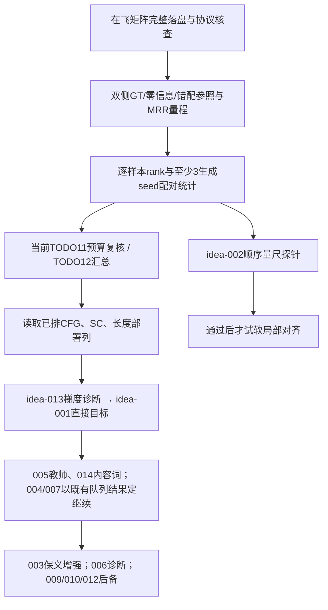

# 下一步科研与执行指导 · 2026-10-14

## 0. 阅读结论与范围

下一笔新增研究预算优先检验**正确文本是否带来可泛化的去噪收益**，而不是再增大旧语义权重或增加条件层。先完成量尺和预算裁决，再读取已排L1与结构臂，最后决定新增目标实验。理由不是新论文流行，而是仓库的条件弱响应、B目标的历史正效应与时序量尺盲区相互约束；这些证据仍不足以宣布主因已经因果确诊。

本轮问题固定为：RQ1 哪些机制能在冻结表示/x0/纯文本下直接增加正确条件的收益？RQ2 当前量尺与在飞任务足以裁决哪些问题、缺什么？RQ3 文本扩增与时序对齐是否真有新信息和可检验机制？本报告分别在§3、§2/§4、§5回答。候选/执行授权分离，未启动任何训练、评测、下载数据或修改队列。

只修改本文件、`THINK_TRIAGE_20261014.md`、`THINK.md`、追加`FAIL.md`。本轮禁止改TODO覆盖RULES第7条的一般登记要求，裁决入口改为上述文件；并不修改D1–D8。既有D9–D14也读取遵守。

**协议P**（**2026-10-15 修订为 test 单侧**，见 TODO D26；以下为 2026-10-14 原文）：test全量642 + 固定train采样642、同协议、至少3生成seed、按ID和seed配对统计，MRR/top-1晋级，SignMbart/FVD仅汇报，不使用dev选点。来源：`.trae/documents/RULES.md`第6条、`.trae/todo/TODO.md`D1–D3及任务11、本轮用户判据。后文所有晋级均指P。训练内部固定holdout只用于教师/长度头等训练过程选择；不把它当方法指标筛选集。半天探针只否决机制，不替代P。

## 1. 现状事实与口径冲突

缩写：R=`.trae/documents/archive/NEXT_BLEU_FVD_REVIEW_20261014.md`；N=`.trae/documents/NOTES.md`；T=`.trae/todo/TODO.md`；表=`reports/eval/RESULTS_TABLE_20261014.md`。每一历史数字保留原split/协议；本节不是新模型比较表。

| 事项 | 查到的事实 | 出处/限制 |
|---|---|---|
| 部署权重 | `runs/dit_b_prefix30k/final_60k.pt`；90k仍待裁决 | T D4；当前任务11复核、12汇总；旧F-001/THINK把复核写TODO12，编号已过时 |
| D1与代码不完全一致 | 决策DPM-Solver++(2M)/50；矩阵显式传 `--solver dpm-solver++ --solver-order 2 --steps 50`；基础YAML仍 `sampling.sampler: ddim` | `tools/eval_matrix.sh`生成段；`configs/dit_b_text_prefix.yaml::sampling`。不能宣称所有入口默认已统一；本轮不改代码/配置 |
| CFG | 矩阵基线2.0；3.0、区间与rescale为已排候选，未由全量矩阵裁决 | `tools/eval_matrix.sh`；`reports/queue/jobs.txt` CFG行；R§8.5的test-32改善只作动机 |
| 锚点/长度 | 解码所有样本读取GT首帧；矩阵主列oracle长度；predicted列独立排队 | `tools/eval_t2v.py` reference_image与length_mode；T D7；queue `_predlen`。oracle列是诊断列，不冒充全纯文本部署长度 |
| 长度头 | 8桶expectation已部署；test MAE16.44 vs该模型median17.48；train采样expectation16.22。头选择用train内部holdout | T D10/D14；N「深夜」长度头对照表；`tools/eval_t2v.py`读取payload readout。与旧MAE18.3不是同协议改善比较；回译/检索部署效果待P |
| 重建/地板 | test-32 SignMbart错配真视频B1 9.32；重建B1 31.57、MRR0.246、FD28.37 | R§2；表参照段。表主体重建B1写31.56，不能为整齐改来源数字；全量需重标 |
| 随机/量程 | test-32随机MRR0.127；dev-64随机0.074、真实latent0.1986≈0.199 | R§8.2；不是同一上限。MRR可用量程差分别约0.119和0.1246（直接相减）；全量未知 |
| 噪声 | 同checkpoint/seed的历史dev-64重跑ΔB1 0.62 | R§8.6；既非生成seed标准差，亦非全量test晋级阈值 |
| pad病理 | latent query pad注意力40.2%，真词12.1%；mask等预算MRR0.1079 vs0.1077 | R H15；N「傍晚」；FAIL-003。病理存在不推出修它有收益 |
| 文本通道 | 换文本最终输出约1%；cross-attn有效贡献约MLP3%，另有逐block平均4–6%口径 | N「2026-10-12 深夜二」修订；`tools/probe_stats.py`。用户问题中的5–10%是旧错误分块统计，不再当事实 |
| 顺序盲区 | 真latent逆序MRR0.241 vs正放0.246；FD32.07 vs28.37；逆序B1 14.97 | R§8.1/表退化段。只说明历史同控制对顺序不敏感；“优于所有生成”限定于当时样本和表，不能推广为全量当前结论 |
| 语义可达性 | F-005 matcher真实gap0.327、生成0.205；有信号不代表可被安全优化 | `reports/eval/semantic_reachability_prefix60k.json`；FINISH F-005；T D11。此gap不是latent→文本NLL，不与旧0.675混算 |
| A因果对照不成立 | control从A final再训且text仍trainable；A/control不是冻结/微调等总预算比较 | `tools/run_preferred_followup.py` cases/init-model；`configs/dit_b_text_finetune.yaml`。表0.078/0.137仍为历史事实，不能据此证明漂移或“解冻必坏”；FAIL-006原决定保留 |
| 现有实现 | SC、课程、双流、容量control、REPA、动态损失已有代码/配置并排队 | T3/5–9；STRUCTURE；queue；不能再写“需要从零实现” |

E/F/D/B的完整基线、D1–D8逐条约束、FAIL-001..006复活条件、FINISH F-001..004见 `THINK_TRIAGE_20261014.md` §1。F-005/006新增现状已纳入，没有擅改原档案。

## 2. 在飞任务实测、尚未解锁的判断

### 只读快照

2026-10-14约18:27–18:28（Asia/Shanghai）读取 `ps -eo pid,ppid,etime,args`、`reports/eval/matrix/` 文件、`reports/eval/logs/matrix_gen_*.log` 与 `reports/queue/jobs.txt`：

| 任务 | 进程/磁盘证据 | 当时状态 |
|---|---|---|
| prefix60k test | matrix父PID3493016 / eval_t2v子PID3493077；日志 `matrix_gen_prefix60k_test.log` | 506/642生成；GPU4，未有全量meta/BT/FVD/检索结果 |
| prefix60k train | 父3493070 / 子3493197；`matrix_gen_prefix60k_train.log` | 476/642生成；GPU5 |
| prefix90k test | 父3493190 / 子3493298；`matrix_gen_prefix90k_test.log` | 520/642生成；GPU6 |
| 调度器 | PID3597049，`tools/gpu_queue.py --queue reports/queue/jobs.txt --gpus 4,5,6 --max-parallel 3 --min-free-gib 12` | 存活；排队不等于训练已启动 |
| 已落盘小样本 | `matrix/smoke8/test_n8/{meta.json,fvd.json,bt_signmbart/score.json}` | 仅smoke已见这些文件；不是P完整结果 |

进度是快照，不能写成完工结果。最终复核快照见文末；本轮不控制进程。queue有route_e/f/g/h/i/j/k训练与两侧评测、prefix_120k续训、prefix90k train、CFG/rescale与predicted-length两侧；队列内容可证明“已排”，不能证明实际完成。

### 首次矩阵跑完能/不能解锁什么

可以开始核对双集清单覆盖、指标完整性、全量候选集下的单seed读数和train/test差异；prefix90k仍须等其train侧。不能凭首轮直接裁决D4，也不能声称“至少3seed”已完成：`tools/eval_matrix.sh`没有seed循环，`tools/eval_t2v.py::parse_args`默认生成seed42；队列未覆盖多生成seed。固定采样seed42只是抽样身份。

读代码还发现四个统计入口限制，建议后续获执行授权时处理，本轮不改：

1. `tools/probe_latent_retrieval.py::summarise`只输出MRR/top1等聚合值，**没有逐视频rank/reciprocal-rank落盘**。现成 `tools/bt_paired_stats.py`是回译统计，不等于检索配对CI。需要补持久化rank/候选身份，才能按ID/seed配对。
2. `tools/collect_matrix_table.py::REFERENCES`把历史小集常数写死（包括随机0.074），不能把这个表尾当全量上限。其文字把 `rolled_latents`称时间打乱，但检索源码实际是**跨样本轨迹错配**，不是每条视频帧序打乱。顺序探针必须另做。
3. 汇总 `complete` 主要检查BT数量；完整性判定还需两侧FVD、检索、协议一致、seed齐备。该脚本未自动验证所有协议字段相等，也未展示top-1；D3不能靠当前Markdown单表直接裁决。
4. 检索将对角线唯一ID当正例，重复文本会产生同义/同文候选与tie问题。先保持原D3口径完整报，再提案补multi-positive敏感性分析；不得静默换排名定义只给新方法。train教师在train上拟合，train偏乐观不仅反映生成器过拟合，需两侧各自GT/zero/错配参照（N「晚」协议要点）。

这些缺口不会自动推翻已定MRR门槛，但决定什么时候有资格应用它。D3阈值只能在同一候选集、两侧量程与噪声标定后提出；未标定前不写绝对数值承诺。

## 3. 文献检索方法与五条机制线

检索日期2026-10-14。使用网络搜索及原论文HTML/摘要、出版社页面、作者代码；三个独立视角分别检索手语/数据、条件/时序、目标/表示，并由主代理交叉核对SoftREPA、Text CTC、Text2Sign、TuneSL与iREPA等。优先近年文献，必要基础工作保留较早来源。这里只转述原源可支持的内容；只读摘要的行明确标出，不冒充通读。文献实测均定性转述，不将外部数字与本项目混表。

| 线 | 实际检索词（代表查询，原样） |
|---|---|
| 直接手语 | `SignMoD FlashSign text sign video generation 2025 2026 arxiv`；`"text to sign" "video" 2026 diffusion`；`"SignMoD" "3698334" ieee`；`"FlashSign" followup 2026 "sign"` |
| 条件使用 | `diffusion training classifier free guidance CFG 2025 training objective contrastive conditioning diffusion`；`diffusion contrastive denoising loss mismatched text conditional likelihood training 2025`；`diffusion conditional residual decomposition unconditional prior residual text guidance training`；`Directly Fine-Tuning Diffusion Models on Differentiable Rewards DRaFT paper`；`2025 2026 diffusion token conditioning attention amplification training token importance` |
| 文本扩增 | `"video" "recaptioning" "diffusion" "2025" arxiv caption`；`"recaptioning" "diffusion" "caption" site:openaccess.thecvf.com/content/CVPR2025`；`"Long Video Diffusion Generation with Segmented" arxiv`；`"Mimir: Improving Video Diffusion" arxiv` |
| 时序 | `monotonic alignment unsupervised video text alignment likelihood loss Drop DTW paper`；`2025 video text monotonic alignment likelihood self supervised sign language`；`2025 text to video temporal evaluation order sensitivity FVMD VBench temporal metrics`；`FVMD Fréchet Video Motion Distance arxiv 2024`；`VBench 2.0 2025 intrinsic faithfulness arxiv` |
| 目标表示 | `iREPA 2025 2026 representation alignment diffusion`；`Back to Basics Let Denoising Generative Models Denoise x prediction 2025`；`Min SNR diffusion training self conditioning Analog Bits paper`；`2025 2026 classifier free guidance training guidance free diffusion`；`"Visual Generation Without Guidance" github` |

每行“动作/探针”都是项目提案，不是论文已验证本项目收益。合规列同时区分“原方案”与“只借机制”；禁止因为训练教师不参与推理就声称没有新增监督。

### S. 直接text→sign video：同类失败比异口径高分更有参考价值

FlashSign证明pose-free可以作为研究方向；Text2Sign却直接承认prompt区分弱，说明画面/去噪改善与语义依赖可以分离。TuneSL进一步提醒“无pose”不等于“只有文本”：结构引导来自输入图。因而不能从这些工作推导“更换大视频骨干即可解决E”。

| ID / 题名、来源、年份 | 原源核验与本项目动作 | 合规检查 | 半天探针/是否可执行 |
|---|---|---|---|
| S1 [FlashSign: Pose-Free Guidance for Efficient Sign Language Video Generation](https://arxiv.org/html/2603.27915v1)，arXiv，2026；[作者代码](https://github.com/AIGeeksGroup/FlashSign) | §II-B/C：文本、3D VAE、epsilon目标、时间步tile稀疏注意力。只借训练/推理注意力一致性审计；不搬其骨干 | 文本条件可；更换VAE/epsilon违反H1/H3；单帧单token无空间tile | CPU注意力/FLOPs分解可；若无空间冗余/时间注意力非主要成本，否决稀疏化投入 |
| S2 [Text2Sign: A Single-GPU Diffusion Baseline for Text-to-Sign Language Video Generation](https://arxiv.org/abs/2607.13164)，arXiv，2026 | 摘要明确去文本只小幅改变留出去噪loss、错配prompt与正确近似；迁移correct/shuffled/empty同噪声诊断 | 诊断合规；原3D encoder-decoder不替换冻结VAE | 半天机制探针可，若正确条件优势不可分，否“只看loss就够”；不能据此否决全部长期训练 |
| S3 [Towards End-to-End Text to Sign Language Video with Diffusion Models（TuneSL）](https://link.springer.com/chapter/10.1007/978-3-032-25314-9_16)，Springer，2026上线（ECML PKDD2024 workshop论文集） | 出版商摘要：重复输入图并DDIM inversion作结构引导；借其条件来源审计 | 新增图像引导违反H4，非本项目D7固有解码锚点；不移植 | 静态依赖检查即否整套迁移，无GPU；全文付费，未核验encoder更新细节 |
| S4 [Advanced Sign Language Video Generation with Compressed and Quantized Multi-Condition Tokenization（SignViP）](https://arxiv.org/abs/2506.15980)，arXiv，2025 | 摘要含pose/3D hand经量化token再翻译；用于澄清“压缩token不等于无需pose” | 原版违反H4；不搬FSQ/tokenizer | 半天源码/数据依赖审计可否决整套；不启动训练 |
| S5 [SignRefine: Adapting Foundational Video Models for Sign Language Generation](https://arxiv.org/abs/2609.08496)，arXiv，2026 | 摘要：keypoint条件、手脸空间adapters；是新增邻近工作，非FlashSign已确认后续 | 2D关键点监督/条件违反H4；单帧token无局部空间接口 | 依赖审计即可否；不因近期而复活pose |
| S6 [SignMoD: Sign Language Video Generation via Mixture of Diffusion](https://doi.org/10.1109/TPAMI.2026.3698334)，IEEE TPAMI，2026（仅书目线索） | 题名/DOI检索找到；IEEE原页不可访问，未从满足本轮来源标准的原文核实机制。不得用SSM/MoE宣传解释作为结论 | 条件/监督未确认；**不能宣称合规** | 半天原文获取/依赖审计可作为后续信息任务；现在不能设计可信训练探针 |

S1–S5为已核验原始来源证据，S6为单独的检索缺口，不计入已核验机制论证。PubMed转录/作者单位新闻仅发现SignMoD书目，未把其机制写成论文事实。检索未确认独立FlashSign正式后继论文；S5是新邻近路线，不能冒称后继。现有旧文献中的SignGen/Text2SignDiff也不能当纯文本RGB同条件基线，理由仍见 `SIGN_VIDEO_LITERATURE_20261013.md` §3。

### C. 条件真正被使用：直接目标优先于单纯放大

SoftREPA比泛泛“加语义loss”更贴近idea-001：它已把匹配/错配去噪用于对比。MG把条件差分搬到训练，ContrastiveCFG则留在采样，三者不能混成同一种实验。DRaFT优化生成结果分布，却更依赖奖励可信度；本项目教师顺序盲区使它必须后置。DARE提供细粒度内容词视角，但不支持重开已失败pad-mask。

| ID / 题名、来源、年份 | 核验定位/迁移动作 | 合规检查 | 半天否决探针 |
|---|---|---|---|
| C1 [Aligning Text to Image in Diffusion Models is Easier Than You Think（SoftREPA）](https://arxiv.org/html/2503.08250v5)，NeurIPS2025；[作者代码](https://github.com/softrepa/SoftREPA) | §3.1–3.2正负配对去噪对比+soft tokens；001采用同noise正确/错配x0差 | 只train配对可合规；不搬flow输出/视觉重标注 | 正确误差不变、仅错误误差变坏即否当前目标；幅值变大不足以通过 |
| C2 [Diffusion Models without Classifier-free Guidance（MG）](https://arxiv.org/html/2502.12154v1)，arXiv2025 | §3.2 stop-grad EMA条件/无条件差分进训练目标；为001残差提供最近先例 | 自身EMA合规；epsilon/flow式须推导回x0，不能改预测头 | CPU推导退化点/梯度，再查条件优势；残差范数升而语义无改善即否 |
| C3 [Contrastive Flow Matching](https://arxiv.org/abs/2506.05350)，arXiv2025 | 摘要：区分条件预测flow；借条件可分目标，不声称已证本项目效果 | 原flow/v输出不合规；只借x0辅助约束 | 所有条件互相远离但正确匹配不改善即否；不能只看敏感度 |
| C4 [Directly Fine-Tuning Diffusion Models on Differentiable Rewards（DRaFT）](https://arxiv.org/abs/2309.17400)，ICLR2024（预印本2023） | 摘要：奖励穿过采样反传，截断后段；先做015奖励漏洞审计，再谈生成分布后训练 | 原偏好/美学视觉教师不能搬；域内train教师可考虑；禁SignMbart奖励 | 若奖励偏好静止/倒放或扰动作弊，否该奖励的后训练资格；不先训DRaFT |
| C5 [Not all tokens contribute equally to diffusion learning（DARE）](https://arxiv.org/html/2604.07026v1)，arXiv2026 | §3.2.2–3.2.4/§4.3：token重要性、完整条件与低语义子集差分；为014提供干预对照 | 文本派生干预可；不搬空间SRA、外部视觉教师或pad-only复活 | 先用未参与优化的域内教师标定原文/反事实的相对NLL；量尺通过后，内容词干预不优于等量随机词才否该重要性估计；教师不可分则保持未知 |
| C6 [ContrastiveCFG: Guiding Diffusion Sampling by Contrasting Positive and Negative Concepts](https://proceedings.mlr.press/v306/chang26c.html)，ICML2026（[预印本2024](https://arxiv.org/abs/2411.17077)） | 出版商摘要：正负概念对比采样；作为训练目标与推理放大的边界对照 | 文本负概念可；不加视觉reference，不覆盖D1默认 | 负提示删除正确共享内容即停止；半天冻结模型诊断可，正式比较P |

### D. 一对多与文本扩增：更丰富描述不等于更多同义句

InstanceCap/ShareGPT4Video通过观察视频得到更细动作信息，Presto还使用分段时序描述；这和仅从已有德语句子产生paraphrase的因果信息不同。CogVideoX整体系统结果不能归因成单独recaption收益。Mimir则提示即使仅加文本表示，未校准接口也可能不稳。因此003保留为保义鲁棒性实验，不再承诺解除条件均值塌缩。

| ID / 题名、来源、年份 | 核验定位/可迁移动作 | 合规检查 | 半天否决探针 |
|---|---|---|---|
| D1 [InstanceCap: Improving Text-to-Video Generation via Instance-aware Structured Caption](https://arxiv.org/html/2412.09283v1)，CVPR2025 | §3.1视觉工具与MLLM构造实例/动作描述；§4.3微调结果支持准确细节描述；只迁移文字实体/动作保真质检 | 原视频captioner/检测/分割增加视觉监督，不做；文本内重写可 | CPU审核实体、数值、否定、顺序，漂移则否当前模板 |
| D2 [Long Video Diffusion Generation with Segmented Cross-Attention and Content-Rich Video Data Curation（Presto）](https://openaccess.thecvf.com/content/CVPR2025/html/Yan_Long_Video_Diffusion_Generation_with_Segmented_Cross-Attention_and_Content-Rich_Video_CVPR_2025_paper.html)，CVPR2025 | 摘要：progressive subcaption分段路由；借文本子句软时间路由问题 | 不搬视频captioner监督/GT时间戳；文本软路由可 | 如果必须oracle分段才可定义映射，否硬路由；先审语料而非训练 |
| D3 [CogVideoX: Text-to-Video Diffusion Models with An Expert Transformer](https://arxiv.org/html/2408.06072v2)，ICLR2025（预印本2024） | §3.4/附录F dense caption；条件数据与结构联合系统，不能单独归因recaption | 视觉重描述与新3D VAE不搬；仅文本质量/截断审计合规 | 扩写只增冗词、截断、无可验证信息即不入训练 |
| D4 [Mimir: Improving Video Diffusion Models for Precise Text Understanding](https://arxiv.org/html/2412.03085v1)，CVPR2025 | §2.2/2.3 norm/scale/zero-conv融合与semantic stabilizer；§3.2直接融合不稳。借稳定接口，不搬整骨干 | 输入文本派生表示可；§3.1原v-pred违反H3，必须保留x0；不搬视觉数据链 | 检查token范数、保义一致/反义可分；仅幅值上升或语义漂移则否直接拼接 |
| D5 [ShareGPT4Video: Improving Video Understanding and Generation with Better Captions](https://papers.nips.cc/paper_files/paper/2024/hash/22a7476e4fd36818777c47e666f61a41-Abstract-Datasets_and_Benchmarks_Track.html)，NeurIPS2024 D&B | 出版商摘要：差分视频caption刻画时间变化，改善生成；只借时序描述质量控制 | 原GPT4V视觉captioner违反额外监督约束；不照搬 | 半天文本审核可，无法由文本验证新增动作信息则不声称复现其收益 |

**一致性证据边界**：上述文献没有证明“本项目纯文本paraphrase + 跨seed输出一致性”有效；不编造此类实测支持。信息论推断是：只由T生成T′不凭空增加目标动作Z的信息；它可改善优化/语言覆盖，不保证可识别同文本下动作模态。保义一致性必须与语义反事实分离、跨seed多样性同时诊断，避免全不看文本也通过。

### T. 时序结构监督与顺序指标：先验证它测的确实是顺序

Drop-DTW提供可微匹配并允许跳过离群元素，但匹配路径仍有单调约束；局部窗口和兼容重排属于本项目待验证改造。Text CTC明确提醒手语/口语并非全单调。TC-Bench与FVD偏置研究共同说明画面质量、运动连贯和事件顺序是不同维度。FVMD与VBench不能因名称含motion/faithfulness就直接成为本项目新门槛。

| ID / 题名、来源、年份 | 核验定位/动作 | 合规检查 | 半天否决探针 |
|---|---|---|---|
| T1 [Drop-DTW: Aligning Common Signal Between Sequences While Dropping Outliers](https://papers.neurips.cc/paper_files/paper/2021/hash/729c68884bd359ade15d5f163166738a-Abstract.html)，NeurIPS2021 | 摘要：可微匹配、允许离群点跳过；002先试局部软对齐 | 仅已有latent/text可；不搬外部视觉特征 | 正倒/块置换/重复帧与错文本不可分，否当前对齐量尺 |
| T2 [Improvement in Sign Language Translation Using Text CTC Alignment](https://aclanthology.org/2025.coling-main.219/)，COLING2025 | 摘要明确CTC/attention处理单调与非单调；借软局部辅助似然 | 不默认搬视觉预训练/transfer链；域内train教师，无gloss | 约束增强反而损伤正确似然则否硬全句单调；不判数据无时序 |
| T3 [TC-Bench: Benchmarking Temporal Compositionality in Conditional Video Generation](https://aclanthology.org/2025.findings-acl.241/)，Findings ACL2025 | 摘要：初态/终态与事件变化组合；借退化控制设计 | 评价设计合规；通用判别器不充当训练教师或回译替代 | 同内容正逆序不可分，则拒其顺序敏感称谓 |
| T4 [On the Content Bias in Fréchet Video Distance](https://arxiv.org/abs/2404.12391)，CVPR2024 | 摘要：FVD偏逐帧内容；支持本地R§8退化标定 | 借测试设计，不搬额外视觉监督；FVD仍汇报 | 已有控制可核读；指标不分时间破坏则不据它判断顺序 |
| T5 [Fréchet Video Motion Distance: A Metric for Evaluating Motion Consistency in Videos](https://arxiv.org/abs/2407.16124)，arXiv2024；[作者代码](https://github.com/DSL-Lab/FVMD-frechet-video-motion-distance) | 摘要：点跟踪运动特征分布；只能作为运动一致性候选 | 外部点跟踪器仅评测研究，不进训练；不得换D3或SignMbart | 速度/加速度统计倒序不变则不能称语义顺序；下载/全评测半天不保证，先做分析 |
| T6 [VBench-2.0: Advancing Video Generation Benchmark Suite for Intrinsic Faithfulness](https://arxiv.org/abs/2503.21755)，arXiv2025；[作者说明](https://github.com/Vchitect/VBench/blob/master/VBench-2.0/README.md) | 摘要：从表面质量扩展可控性/内在忠实度；借维度拆分 | 完整外部VLM只可辅助评测研究，不能训练监督；手语理解未验证 | 先核真实/逆序/重复帧明显控制；不能分则不部署整套，完整套件非半天承诺 |

### O. 目标与表示工程：保留x0，迁移优化机制而非换任务

JiT给出干净数据预测的有限容量解释，但其像素图像结果不能证明本项目latent x0优于所有v实现；更直接的原因是用户已限定x0。Min-SNR与SC可作为L1，而REPA/iREPA原版依赖额外视觉教师，合法的是已排域内改写。GFT/MG说明训练时guidance已有先例，不能包装为首次提出。

| ID / 题名、来源、年份 | 原源定位/迁移动作 | 合规检查 | 半天否决探针 |
|---|---|---|---|
| O1 [Back to Basics: Let Denoising Generative Models Denoise](https://arxiv.org/abs/2511.13720)，arXiv2025，2026修订 | 摘要：干净数据预测、像素大patch场景；检查目标参数化/归一化 | 保持latent x0可；改像素生成/去VAE/v预测不允许 | CPU解析目标转换及端点稳定性；不能把等价换算误写新预测头 |
| O2 [Efficient Diffusion Training via Min-SNR Weighting Strategy](https://arxiv.org/abs/2303.09556)，ICCV2023；[作者代码](https://github.com/TiankaiHang/Min-SNR-Diffusion-Training) | 摘要：时间步梯度冲突，裁剪SNR权重；008先看有效权重分布 | 无新监督，x0权重需正确推导，不抄epsilon公式 | 噪声采样分布×loss权重是否压掉有文本作用的段；若是则否当前配方 |
| O3 [Analog Bits: Generating Discrete Data using Diffusion Models with Self-Conditioning](https://arxiv.org/abs/2208.04202)，ICLR2023（预印本2022） | 摘要：self-conditioning；只迁移自身x0反馈，不搬bit表示 | 自身预测不算外部reference；冻结VAE/x0保留 | 检查反馈是否强化无条件先验、跨seed方差缩小而检索不改善；按实际前向成本比 |
| O4 [Representation Alignment for Generation: Training Diffusion Transformers Is Easier Than You Think](https://proceedings.iclr.cc/paper_files/paper/2025/hash/d9e42b4d7163931f3689d6d6fbaa11d0-Abstract-Conference.html)，ICLR2025；[代码](https://github.com/sihyun-yu/REPA) | 摘要：隐层对齐外部预训练视觉编码器；007仅保留域内辅助表示思想 | 原版外部教师违反H4；D12域内latent教师可 | 静态依赖审计先否原版；域内版本查梯度和教师分辨力，不能继承原版增益 |
| O5 [What matters for Representation Alignment: Global Information or Spatial Structure?（iREPA）](https://proceedings.iclr.cc/paper_files/paper/2026/hash/3929a7785bd56f57edcff0152ab41289-Abstract-Conference.html)，ICLR2026；[代码](https://github.com/End2End-Diffusion/iREPA) | 摘要：patch空间关系、卷积投影与归一化；本项目无空间patch格 | 原版视觉教师不合规；时间关系迁移是新假设，不是同模态原版复现 | CPU关系矩阵若对逆序不变，否“它能监督顺序”解释；不否所有对齐用途 |
| O6 [Visual Generation Without Guidance（GFT）](https://proceedings.mlr.press/v267/chen25ac.html)，ICML2025；[代码](https://github.com/thu-ml/GFT) | 出版商摘要：条件模型参数化将guidance融入训练，不必先训CFG再蒸馏 | 保留x0/latent/text原则可；具体公式仍须推导 | CPU退化系数是否回原x0目标；放大输出范数但不增正确优势则否机制解释 |

## 4. 关键路径、预算与可执行入口

### 成本模型（全部为估算，不是新增授权）

旧THINK把全矩阵估为约1GPU-h，已不适用。N「2026-10-14 深夜」记录生成速率约6条/分钟、每侧约1.8h；以该历史吞吐估算，单模型双集×至少3seed仅生成约 **10.8 GPU-h**（1.8×2×3），两模型A/B约 **21.6 GPU-h**，尚未计BT/FVD/候选数平方的检索开销，也未计共享GPU争用。不得承诺半天完成正式晋级。已有产物按协议与seed身份可复用，不重复生成。

训练成本旧THINK/`BRAINSTORM_TEXT_CONDITIONING_20261014.md` C04/C07估20k约2.5GPU-h，只是规划值；以此粗估两臂约5GPU-h、60k续训约7.5GPU-h。最终应从各run `metrics.jsonl` 的实际step耗时更新。SC/双流/成对目标的前向成本不同，不能按step数默认等GPU成本；方法对照报告训练步数与GPU-h两种预算。下面训练成本引用本模型，未知教师/新结构成本标未知，不用假精度。

L1≤可支配时间1/3是用户资源纪律，不应通过把CFG叫L2规避；量尺是共享前置，单列成本；若量尺本身消耗大，先收敛候选数量，不扩大L1网格。

### 阶段图



阶段图是**建议新增工作的顺序**；实际queue已把训练排在部分评测前，本轮不改、不取消在飞任务。读取已有结果可以与探针方案准备并行，但未经P不得先宣布胜负。

| 阶段/动作 | 入口脚本/配置与当前可执行程度 | GPU成本估算 | 前置依赖、判据（P/D3） | 失败表现→下一手 |
|---|---|---|---|---|
| K0 完整性核查 | 只读 `ps`、matrix目录、meta/score/fvd/retrieval；`tools/collect_matrix_table.py`可汇总但有§2局限 | 读日志0GPU；在飞作业成本不追加 | 清单ID完全覆盖，两侧协议一致；所有产物齐，不以BT成功代替全链成功 | 数量/协议/输出身份不一致→修复协议后补缺项，不用dev替代 |
| K1 量程与噪声 | `tools/probe_latent_retrieval.py --use-gt-latents`可算GT；zero/rolled已有；真正帧序变换需扩探针；逐ID rank落盘尚未实现 | 不需新DiT训练；检索成本需测，不能沿用小集1h估算 | 候选集/teacher固定，两侧分别标定；生成seed≥3，rank配对CI；重复文本/tie登记 | GT与地板不可分或噪声吞没差异→005校准教师；换教师则全表重算，保持D3指标族 |
| K2 预算裁决 | `tools/eval_matrix.sh`评60k/90k；现TODO11负责seed，12汇总，120k由任务10已有队列 | 两模型完整3seed生成约21.6GPU-h+评分，扣可复用部分 | K0/K1；P下MRR/top1为门槛，报告各seed与两侧差；阈值标定后预注册，不追看BT选赢家 | CI不分/两主指标冲突→维持D4的60k临时基线并记未裁决；train独涨→不扩宽/深 |
| K3 L1 CFG/rescale | queue全程3.0、区间[200,999]/[0,200]、rescale0.7；`GEN_EXTRA`入口现成，D1不变 | 无训练；每额外完整候选约10.8GPU-h生成+评分 | K2基线；P；只先读已排候选，静态CFG确定后再讨论中段补扫 | 只BT/FVD涨而MRR/top1无可分收益→不晋级；回收预算给E |
| K4 L1 SC | `configs/dit_b_text_prefix_sc.yaml` / route_e / `t2v/train.py` | 旧规划20k约2.5GPU-h需按SC实测上调；评测另计 | 与相同起点、文本冻结状态、总训练预算的control；P | 自身先验强化、文本干预响应下降→停止SC扩展；读001 |
| K5 L1 长度 | `t2v/train_length.py`、`length_model.py`、queue `_predlen`；8桶expectation已用 | 头可CPU；生成评测仍约10.8GPU-h/完整候选+评分 | train内部holdout选头；oracle和predicted两类分别完整双集，不跨长度口径比较 | MAE改善但D3部署收益不成立→报告损失定位，不继续盲增桶；文本回归需另提案 |
| K6 直接E目标 | 001/013；扩展点 `t2v/diffusion/gaussian.py::training_losses`、`t2v/train.py`；`configs/overfit_text_x0.yaml`只是探针起点，新loss未实现 | 半天诊断上限；成对20k训练至少旧两臂约5GPU-h且多前向，正式需测；P另计 | K1/K2；先correct绝对收益再relative gap，负例只train；正式晋级P | 仅wrong变坏/对训练句过拟合→冻结或约束负分支、换负例；再失败转005/已排004，不能加margin硬顶 |
| K7 结构/课程 | route_f/h/i、`dit_b_text_prefix_{curriculum,dual4,dualctl4}.yaml` | 已排3臂；旧每20k约2.5GPU-h只是下游估计，实际容量FLOPs要核 | P；双流必须对容量匹配，课程独立；对SC等需独立等预算baseline | 只有容量收益→报告容量机制，不称条件结构成功；无收益则不再加层 |
| K8 顺序目标 | 002；`latent_text.py`现成teacher；Drop-DTW/soft局部loss与变换评测尚未实现 | 半天teacher探针；新teacher成本未知；正式20k用成本模型 | K1顺序量尺有信号且文本错配控制通过；P晋级，顺序只作机制证据不改D3 | 真latent当前teacher不分→先换合法教师/量尺；强单调伤正确配对→放弃硬单调，不宣判latent无信息 |
| K9 教师/REPA/动态 | 005与route_j/k；`repa.py`/`dynamic_loss.py`；D12域内teacher | j/k已排；两个20k旧估约5GPU-h，教师升级另估 | D11不加旧λ；域内教师先可靠；P；不同gap量纲分开 | 教师reward偏退化→015审计后拒后训练；动态能量塌缩→停该loss，不将平滑当动作正确 |
| K10 文本数据/适配 | 003/014/006；text adapter/conditioner为扩展点，文本增强流水线与LoRA未实现；route_g已排 | 半天CPU先筛；后续训练另计 | 语义保真、train-only构造；保持D3教师独立；P | 保义变换漂移→拒该模板；敏感只幅值升→不训；A成因不明→仅保留诊断 |
| K11 后备 | 009重排、010粗计划、012外域；`tools/probe_external_data_feasibility.py`仅012入口已有 | 重排按候选数增latent采样；粗计划高成本；外域小探测原估0.2GPU-h | 独立教师/计划可预测/可解码与数据授权分别满足；任何收益仍P | 任一前提未过继续parked；不拿新论文复活FAIL |

**SC代码纠正**：文档称推理“两轮迭代”不精确；`t2v/diffusion/gaussian.py::{ddim_sample_loop,dpm_solver_pp_sample_loop}`每时间步复用前一步x0作为self_cond，不是必定每步再额外跑一次完整采样。训练路径有概率执行no-grad首遍。预算按实际调用次数测，不照抄文档的倍数。

### 供后续执行者使用的命令模板（本轮未执行）

矩阵已经在跑，不复制启动。缺失生成seed在确认K0/K1改进、用户授权后补；必须唯一输出tag，避免 `meta.json` 存在即跳过采样。示例seed42/43/44是**提议固定集合**，不是已完成事实；样本清单仍seed42不变：

```bash
# 后续执行示意，不是本轮启动；<GPU>替换为获准空闲设备
GEN_EXTRA="--seed 43" bash tools/eval_matrix.sh prefix60k_s43   configs/dit_b_text_prefix.yaml runs/dit_b_prefix30k/final_60k.pt <GPU> 642 all
GEN_EXTRA="--seed 43" bash tools/eval_matrix.sh prefix90k_s43   configs/dit_b_text_prefix.yaml runs/dit_b_prefix30k/final_90k.pt <GPU> 642 all
# 相同seed集合下补其它seed；复用既有seed42前先核实完整协议。
# 真latent参照（须相应meta已落盘），train侧对应更换split与run：
python tools/probe_latent_retrieval.py   --run reports/eval/matrix/prefix60k/test_n642 --split test --use-gt-latents   --tag gt_test642 --gpu cuda:<GPU> --out <新的获准输出路径>
```

当前工具还没有MRR逐样本paired-bootstrap入口，不能编造命令说已支持。拟实现输出 `video_id/candidate_ids/seed/rank/reciprocal_rank/top1/teacher_hash/protocol_hash`，然后对固定候选库的paired差做视频与seed分层不确定性估计；重复抽样时不隐式改变候选库。D3数值容忍度来自K1噪声标定，不在本轮凭感觉设置。每侧均展示train/test，不以更好的一侧替代；若只有train提高，按过拟合/teacher训练偏倚分别排查。

## 5. 文献×仓库机制交叉、三张卡新颖性与排序

| 机制/文献 | 本地支持 | 本地反对/缺口 | 决策含义 |
|---|---|---|---|
| 正负去噪目标（C1/C3）、训练guidance（C2/O6） | B vs同起点续训control的历史MRR0.171/0.137（表对应行）；换文本输出仅约1%（N通道修订） | 未有该目标的项目实验；可能只抬高wrong；A/control不是公平文本微调对照 | 001研究效用优先；013定位梯度；先修“正确真的改善”判据 |
| token语义覆盖（C5） | 整句弱响应、真词注意力12.1%（R H15） | pad mask无收益，注意力不是因果使用 | 014只做内容词与随机词干预；不复活FAIL-003 |
| 序列/局部对齐（T1/T2/D2） | 真正反序MRR差仅0.005（R§8.1两数相减）；旧指标看不见顺序 | 德语不是手语转写、无词帧标签（SPARRING R3）；当前teacher不一定可提取顺序 | 002量尺先行，目标后置；拒硬全句单调 |
| 文本扩增（D1–D5） | 小语料、句级弱配对（N「晚」、SPARRING） | 视觉recaption的新增信息来源不可用；纯paraphrase不能凭空增加动作模态 | 003降L2和优先级；只保义鲁棒性，不保证治均值 |
| 生成后训练（C4） | matcher生成gap存在（F-005） | teacher顺序盲区、reward自证，gap不是安全梯度证明 | 015先审计，DRaFT暂不训练；009重排仍parked |
| CFG/SC/Min-SNR（C2/C6/O2/O3/O6） | 历史CFG2→3 MRR0.153→0.205（R§8.5，test-32），D1已定 | 全量未裁决；优化/采样可能只改善先验 | L1收已有队列，时间≤1/3；不得把这些历史差搬成全量预测 |
| REPA/iREPA（O4/O5） | 域内实现已接（T8/9/D12，STRUCTURE） | 原文外部教师不合规；单token无空间patch；域内教师弱 | 007只收既有合法实验，不新下载外部视觉teacher |
| 大模型/预算（S1/S2） | 已能生成连贯画面，30k→60k旧记录同向（R§8.7） | 60k/90k排序冲突，Text2Sign也报告弱prompt敏感 | 011做对照，不能当默认扩预算理由；量尺先裁决 |

### idea-001/002/003本轮最终新颖性结论

- **001：已核验，广义机制不新；具体项目组合新颖性尚未成立。** SoftREPA已有匹配/错配去噪对比，MG/GFT已有训练期条件差分/重参数化，CFM已有条件可分性压力。保留高实验优先级，降为L2机制验证；若未来在冻结单token手语latent上证明“正确条件优势”而非错误分支作弊，才有项目贡献论据。不能写首次把条件有效性写进目标。
- **002：已核验，算法构件有先例。** Drop-DTW、Text CTC/attention与TC-Bench覆盖其局部对齐/评价构件；语言顺序不等于动作顺序。保留量尺支线和软局部候选，潜在L3价值必须由本项目可提取性与生成机制实验证明。
- **003：已核验，文本重描述/增强/稳定融合有先例；“纯改写解决一对多均值”未得到支持。** 文献视觉recaption收益不能用于给纯文本改写保底。改名保义文本等价增强，降L2，删除跨seed强一致的默认设计。

“具体组合新颖性尚未成立”不是检索未完成的占位符：本轮已完成相邻机制检索并给出**不能主张广义原创**的裁决；更窄组合是否首次需后续穷尽式查新，不能由本轮未找到精确同构证明。

### 对原卡逐张修正

| 卡 | 优先级/状态修正 | 判据与事实修正 |
|---|---|---|
| 001 | 保持E主战场首位，L3降L2 | 删除“预期不低于B”和+0.10MRR承诺；NLL优势wrong−correct；批内负例不自动泄漏；小探针不晋级 |
| 002 | 顺序量尺前移，训练目标后置 | 当前教师失败不等于数据无顺序；硬改软局部；D3不被新顺序指标替换 |
| 003 | 降L2/后置 | 去掉槽位换义配原视频、纯CPU全流程和均值治愈叙事；互检索混淆不构成增强因果证据 |
| 004 | 保留accepted，先收队列 | 课程实际0.30→0.05（config）；实现不再写未开始；必须容量控制，不把pad注意力病理当成功预言 |
| 005 | 教师校准先于新训练 | F-005已完成原TODO10探针；不加λ（D11）；不把cosine/NLL两个gap比较倍数；C序列teacher已存在 |
| 006 | 降为成因诊断 | 修A/control等预算误说；漂移未证；不承诺回收0.059MRR（历史差见表）；FAIL-006仍关闭 |
| 007 | 保留已排实现，停止新网格 | teacher固定D12不是随意换matcher；高R²不能否对齐收益；不引外部教师 |
| 008 | 量尺首位、L1封顶 | 删除B1/B4晋级条件、~1GPU-h全矩阵估计；SC/长度已实现；C03只指向002；正式P统一 |
| 009 | candidate降parked | NFE变化不证明多seed质量分散；禁止同一teacher自选自评；无需所有候选解码回译 |
| 010 | 保持parked | 小探针只能否当前计划预测假设；不设1.5×随机未经全量标定阈值 |
| 011 | 预算复核前置、扩宽后置 | 当前T10扩预算、T11seed复核、T12汇总；不额外重复80k；B1不作晋级门槛 |
| 012 | 保留parked | 不从WLASL推导别域必败，也不默认允许下载；PSNR/离群门槛为提案，不称实测规律 |

原卡中001/005/006/007用dev-64量程和效应推演新收益，008/011仍含BLEU硬门槛；009小样本独立BT判断也不能晋级。它们均已在THINK正文改为P，而非只加一条页首免责声明。旧README/DESIGN/FINISH的dev复现命令、旧TODO任务文字B4门槛本轮按授权不改：执行时遵循本轮明确的P/D3，冲突在此登记，不能照旧跑dev筛选。

## 6. 不做与后备边界

| 不做/继续parked | 原因与替代 |
|---|---|
| 改VAE、多token解码、pixel_refine、epsilon/v输出 | 硬约束与FAIL-001；只在现latent/x0上推导loss/采样等价换算 |
| pose/gloss/关键点/光流/reference生成条件；外部视觉teacher训练 | SignViP/SignRefine/TuneSL及原版REPA边界；只借机制，不继承原方案监督 |
| 再做pad-only mask或再加同样cross-attn | FAIL-003/005；若014内容词诊断无独立贡献，合并回001，不偷换名复活 |
| 继续扫旧语义λ | T D11与已有扫描；先005可靠性/015奖励漏洞 |
| 硬按德语词序对齐整段/压到文本token数 | SPARRING R3、FAIL-004、Text CTC非单调证据；002只软局部 |
| 用视觉captioner生成动作详述 | 新视觉监督违反约束；003只保义文本，明确它不增加动作信息 |
| 大规模外域下载/直接WLASL训练 | FAIL-002；012选不同语料并获授权小探测后再谈 |
| best-of-N、DRaFT立即开训、两阶段粗计划 | 独立量尺/奖励/可预测性未过；009/010parked、015仅candidate诊断 |
| 扩展所有CFG区间与宽深网格 | L1≤1/3，K1/K2未过；先读已排任务，不能以新颖性低为由跳过必要control |
| 用单seed、单集或旧dev数字宣告晋级 | P/D3；teacher/候选数一变就需整表重算，禁止新旧表择优拼接 |

## 7. 新卡与交接

已写入THINK：**idea-013** 分噪声条件梯度审计、**idea-014** 内容词干预覆盖、**idea-015** 生成奖励可利用性压力测试；全为candidate，不新增TODO，不开工。三卡对应不同证据缺口：013选择该动哪个目标，014检查整句分数掩盖的关键词，015防止有gap但可被优化作弊。都列了与001/003/004/005/008/009及FAIL的去重关系。若013/014最终只复制既有探针，应MERGE回承接卡，不能以新编号占独立训练预算。

每张新卡包含层级、瓶颈、做法、假设、增益区间/置信度、成本、风险、半天否决、合规、日期、去向与正式验收。没有根据文学叙述伪造正增益区间：诊断卡直接提分为无，训练收益未知，等量尺和探针建立后再估计。

RQ回答：条件目标最直接但已有先例，项目贡献要靠正确条件优势的证据（RQ1）；现矩阵只开始解决覆盖，统计与量程仍有代码层缺口（RQ2）；文本改写更适合鲁棒性，时序需软局部且先有可靠量尺，不可假设新增监督信息（RQ3）。

## 8. 自检、局限与交付核验

- 每个本地实测数字已标文件/章节/字段；派生差值注明相减，GPU成本注明旧吞吐/估算，种子示例与否决阈值注明提案。没有对新卡承诺未测收益。
- 每个出池裁决在THINK §6指向FAIL，新增FAIL-007..018有七字段；原FAIL-001..006保留。KEEP不伪造失败条目；不确定的009/010/012留parked。
- 新idea-013..015均有半天否决判据、去重与合规；半天不承诺完成正式P晋级，资源不足只保持未知。
- 没有dev筛选或混GFSLT口径；历史dev/test小集只作为口径明确的事实。D3保持MRR/top-1门槛，SignMbart/FVD仅汇报，教师升级不允许静默改变比较尺。
- 文献每条原始URL与核验深度明确；SignMoD仅书目线索、原文未核验，未用二手机制结论；未找到FlashSign后继不等于证明不存在。论文外部收益没有与项目数字并排排名。
- D1–D8无新增冲突；显式登记D1与基础YAML不一致、旧文档dev判据、旧TODO映射、A因果对照混淆；不暗改用户既定决策。D11/D12/D14也保持。
- 主瓶颈E是工作归因，尚未有新协议因果证明；x0-MSE并非数学上不能利用文本。描述质量、语义鲁棒性、动作多样性、时序顺序是不同问题，未合并为一项已证结论。
- 自我反驳检查：纳入Text2Sign弱prompt反例、pad修复负结果、文本CTC非单调证据、recaption额外信息来源、REPA外部监督限制；没有只选支持主张的论文。当前检索并非穷尽查新，不申称“首次”。
- 文件范围和索引/档案一致性在交付前用只读检查核验；结果补记如下。

### 交付前只读复核记录

2026-10-14 18:44（Asia/Shanghai）再次读取进程/目录/日志：prefix60k test与prefix90k test生成已完成，均已落 `meta.json/latents.pt` 并进入SignMbart进程；两者 `bt_signmbart/score.json`、`fvd.json`仍未出现。prefix60k train日志为599/642，仍生成中。来源：对应 `reports/eval/logs/matrix_gen_prefix{60k,90k}_{test,train}.log`、`reports/eval/matrix/` 文件存在检查与ps；没有据此填写未完成指标。

本轮开始与交付前对140个源文件/配置/脚本/关键文档的SHA-256比较：仅THINK.md与FAIL.md变化，其余138个保持一致（包括TODO/NOTES/FINISH、代码/配置/tests/tools）；另新增本报告与裁决报告。FAIL原文前缀SHA-256为 `51bfa0af91c2f5f666b34633042a0f847bc5fd61825040f54cebe6500fd8c6c6`，与追加前一致。runs/reports有后台任务持续写入，未声称它们全局静止；本轮工具仅只读访问，没有向这些目录写文件。

结构检查通过：THINK索引与正文15张卡一一对应，013–015均candidate并具全部字段；010保持parked；新增FAIL-007..018逐条有七字段、“未做实验”说明和THINK出池指针。文献表S/C/D/T/O分别6/6/5/6/6条，其中S6仅书目缺口，其余对应原始源论证。`git diff --check`无空白错误；本轮Markdown另作逐文件结构/尾随空白检查。未运行任何训练或评测命令。

反向审阅补记：014的“语义方向”预注册为域内独立教师的相对NLL差：`d(z)=NLL(z,反事实文本)−NLL(z,原文本)`；同noise生成的原文响应应比反事实响应有更大的d，另与等量随机词干预、保义改写对照。先在真实train配对及正确/错配控制上确认教师能区分该语义干预；不能区分则记“量尺未过，未知”，不否决token机制。该差只用于机制诊断，不能替代P下MRR/top-1晋级。Drop-DTW跳过离群元素仍保留单调路径，不能冒称已解决非单调；SoftREPA作者仓库由主代理本轮网络结果额外核对。
